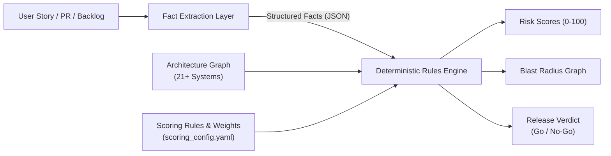
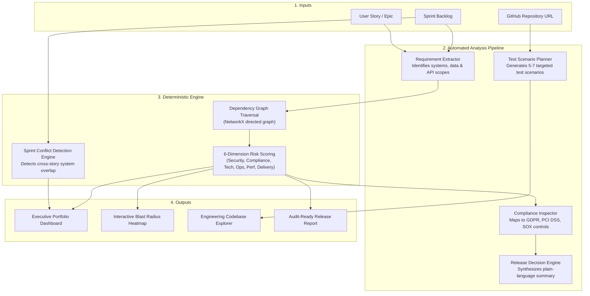

# Architecture & System Design — ScopeGuard

**ScopeGuard** is an enterprise change-impact analysis system built for high-stakes architectures (such as banking and financial systems). It identifies potential failure points, blast radius, compliance exposure, and deployment risks *before* code is deployed.

**Author:** Yash Rai ([yashwardhanrai2007@gmail.com](mailto:yashwardhanrai2007@gmail.com))

---

## 🎯 Core Design Philosophy: "Extract Facts, Deterministic Code Decides"

In enterprise and regulated environments, non-deterministic scores cannot be audited or trusted for release governance. ScopeGuard solves this through a hybrid pipeline:

1. **Structured Fact Extraction**:
   Extractors parse natural-language specifications to identify what systems are modified, what change types are involved (e.g. database schema, public API, authentication flow), and what data is touched (e.g. PCI cardholder data, customer PII).
2. **Deterministic Computation**:
   Every risk score, compliance flag, test recommendation, and release decision is computed deterministically in Python using graph traversal algorithms and transparent scoring weights.

---

## 🔄 End-to-End Workflow

---

## 📊 6-Dimension Risk Scoring Engine

The risk engine evaluates six dimensions on a 0–100 scale:
* **Security Risk**: Touches customer authentication, cryptographic secrets, or cardholder data environments.
* **Compliance Risk**: Triggers GDPR (Right to be Forgotten, PII storage), PCI DSS (cardholder flow), or SOX audit trails.
* **Technical Complexity**: Number of services, downstream dependencies, database migrations, and public API contracts affected.
* **Operational Risk**: Downtime requirements, batch windows, and failover requirements.
* **Performance Impact**: Latency-sensitive critical payment/identity paths and query throughput.
* **Delivery Risk**: Story estimation size, cross-team service ownership conflicts, and sprint dependencies.

---

## 🛡️ Multi-Tier Resilience & Offline Operation

Every stage features an ordered fallback chain:
1. **Primary**: Token Harbor (DeepSeek v4.1 Flash)
2. **Secondary**: OpenRouter (Nemotron 3 Super)
3. **Tertiary**: OpenRouter (Inkling)
4. **Fallback**: OpenRouter Auto-Select Free Models
5. **Zero-External Safety Net**: Built-in deterministic heuristic rule engine

If network access is unavailable, API keys are omitted, or upstream rate limits are encountered, the system functions completely offline without interruption.
