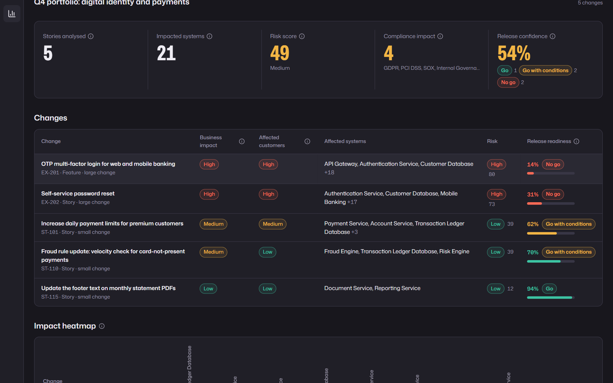
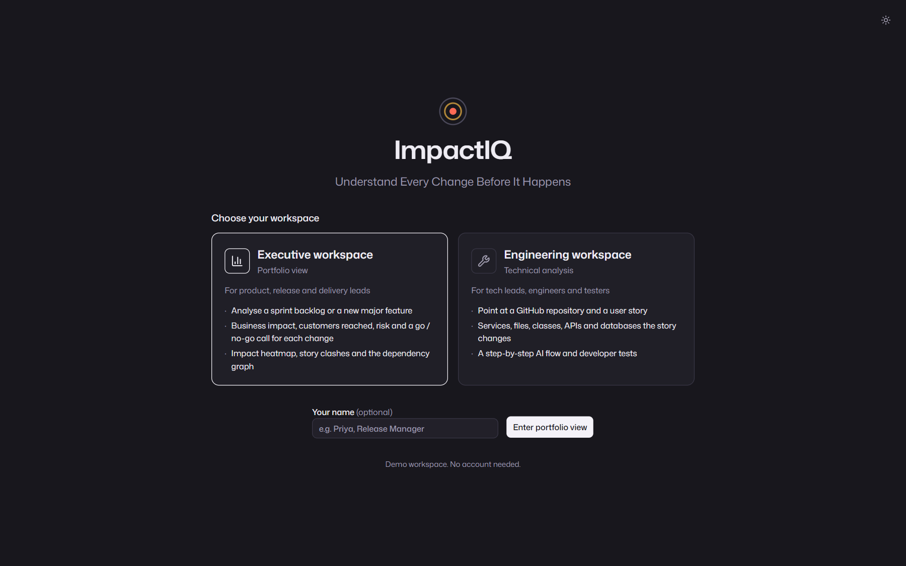
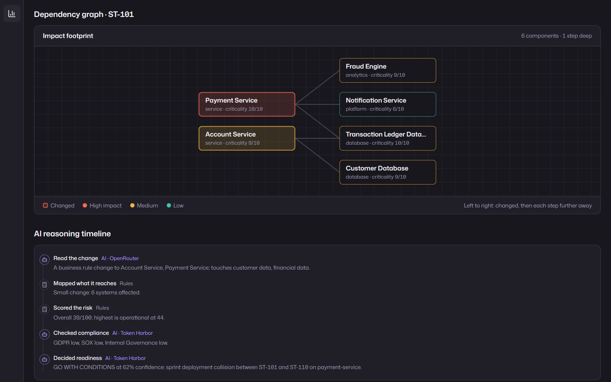
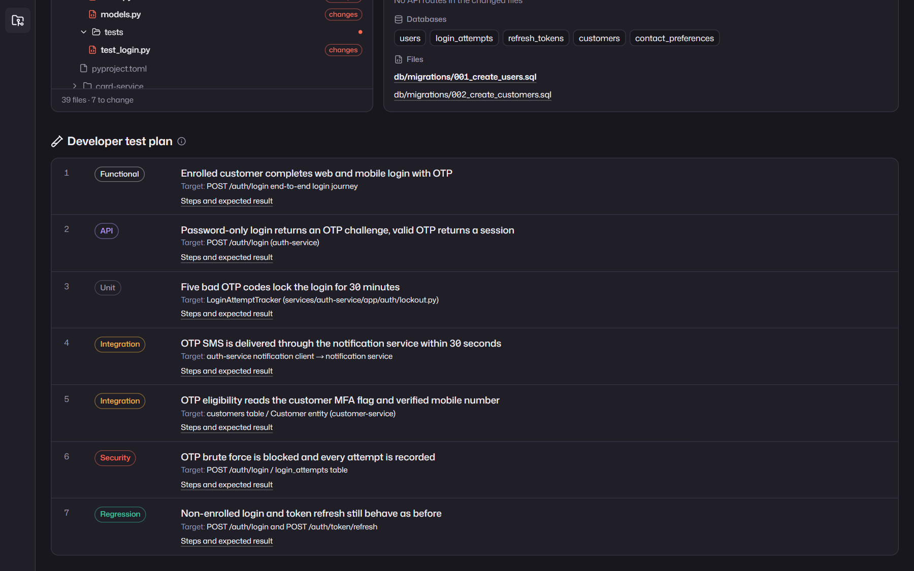
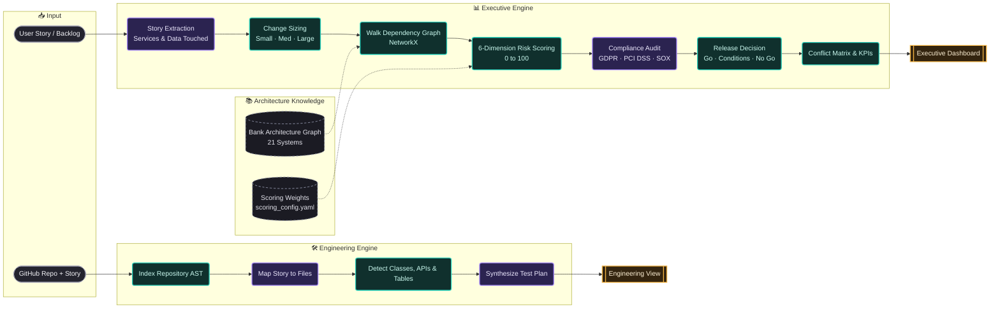

# ScopeGuard

**Understand every change before it happens.**

**Author:** Yash Rai ([yashwardhanrai2007@gmail.com](mailto:yashwardhanrai2007@gmail.com))

> 📁 **Application Code:** all source code (backend, frontend, demo data, and architecture definitions) is located in the [`Project/`](Project) folder.

**ScopeGuard** is an enterprise change-impact analysis system designed for complex, regulated architectures. It answers the critical release question before any code is merged:
> *"What will this change break, how risky is it, and is it safe to release?"*

Provide a user story (e.g., *"Add OTP login for mobile banking"*), an entire sprint backlog, or a story linked to a GitHub repository. **ScopeGuard** traces every affected system and code file, calculates risk across six dimensions, audits compliance requirements (GDPR, PCI DSS, SOX), generates developer test scenarios, and issues a deterministic **Go / Go with conditions / No go** release decision with complete transparency.



---

## 📑 Contents

- [Key Features](#key-features)
- [The Two Workspaces](#the-two-workspaces)
  - [Executive Workspace](#1-executive-workspace)
  - [Engineering Workspace](#2-engineering-workspace)
- [System Architecture & How It Works](#system-architecture--how-it-works)
- [Why the Risk Scores Can Be Trusted](#why-the-risk-scores-can-be-trusted)
- [Quick Start](#quick-start)
  - [Running with Docker Compose](#running-with-docker-compose-recommended)
  - [Running Locally Without Docker](#running-locally-without-docker)
- [API Overview](#api-overview)
- [Project Structure](#project-structure)
- [Tech Stack](#tech-stack)
- [Documentation Links](#documentation-links)
- [Author & License](#author--license)

---

## ✨ Key Features

* **Automated Story Analysis**: Parses natural-language user stories to map downstream system and database impacts.
* **Deterministic Risk Scoring**: All risk calculations, blast radius maps, and release verdicts are computed in pure Python using deterministic rules—eliminating hallucinations.
* **Sprint Conflict Engine**: Detects concurrent stories in the same sprint that collide on the same services, APIs, or database tables.
* **Regulatory Compliance Audits**: Automatically flags requirements under GDPR, PCI DSS, and SOX.
* **Targeted Test Generation**: Synthesizes 5–7 actionable developer test cases tailored to the affected components.
* **Codebase AST Indexer**: Directly maps user stories to real files, classes, methods, and routes in a GitHub repository.
* **Zero-Setup Offline Mode**: Operates out of the box using built-in banking architecture fixtures and heuristic fallback rules without requiring external API keys.

---

## 🖥️ The Two Workspaces

The platform provides two dedicated workspaces tailored for different stakeholders:



| Feature | Executive Workspace | Engineering Workspace |
|---|---|---|
| **Target Audience** | Product Leads, Delivery Managers, Release Governance | Tech Leads, Software Engineers, QA Leads |
| **Primary Input** | Sprint backlog or single major feature description | GitHub repository URL + user story |
| **Output Provided** | Blast radius, portfolio risk scores, compliance alerts, Go / No-Go calls, sprint conflict engine | Services, files, classes, endpoints, database migrations, and targeted developer test plans |

### 1. Executive Workspace

* **Portfolio at a Glance**: Real-time KPI summaries covering stories analyzed, impacted systems, aggregate risk score, compliance posture, and release confidence.
* **Interactive Blast Radius Heatmap**: Visualizes touched systems color-coded by blast radius severity.
* **Sprint Conflict Matrix**: Automatically surfaces cross-story dependencies to prevent release clashes.
* **Reasoning Timeline**: Live audit log showing which models or deterministic rules evaluated each step.



### 2. Engineering Workspace

* **AST Codebase Explorer**: Visualizes the target repository file tree, highlighting exact files, classes, and methods to modify.
* **Architecture Impact Summary**: Shows impacted API endpoints and database tables.
* **Developer Test Plan**: Generates unit, integration, and security test scenarios with preconditions, actions, and expected results.



---

## 🏛️ System Architecture & How It Works



---

## ⚖️ Why the Risk Scores Can Be Trusted

**"Structured extraction; deterministic code decides."** 
Risk numbers and release calls are never generated arbitrarily. The extraction layer isolates structured facts from natural-language specifications. All scoring is evaluated by deterministic algorithms over the system dependency graph ([`data/architecture.json`](Project/data/architecture.json)) and configurable scoring rules ([`scoring_config.yaml`](Project/backend/app/scoring_config.yaml)).

| Reason for Risk Addition | Security Points Added |
|---|---:|
| Baseline Score | 8 |
| Touches Cardholder Data (PCI DSS) | +25 |
| Modifies Customer Authentication Flow | +25 |
| Exposes Public API Changes | +15 |
| Critical Identity Path Dependency | +10 |
| High Transitive Component Blast Radius | +10 |
| **Total Security Risk Score** | **93 (No-Go Threshold Triggered)** |

---

## 🚀 Quick Start

### Running with Docker Compose (Recommended)

1. Make sure **Docker Desktop** is running.
2. Enter the `Project/` folder and start the containers:
   ```bash
   cd Project
   docker compose up --build
   ```
3. Open your browser:
   * **Frontend Application**: [http://localhost:3000](http://localhost:3000)
   * **Backend API**: [http://localhost:8000](http://localhost:8000)
   * **API Docs (Swagger)**: [http://localhost:8000/docs](http://localhost:8000/docs)

> [!TIP]
> No API keys are required for the demo. To connect external language models, simply add your keys to `Project/.env`.

### Running Locally Without Docker

* **Backend (Python 3.12)**:
  ```bash
  cd Project/backend
  python3 -m venv .venv && source .venv/bin/activate
  pip install -e .
  uvicorn app.api.main:app --reload --port 8000
  ```
* **Frontend (Node.js 20+)**:
  ```bash
  cd Project/frontend
  npm install
  npm run dev
  ```

---

## 📁 Project Structure

```
scope-guard/
├── Project/
│   ├── backend/
│   │   ├── app/
│   │   │   ├── agents/          # Story extraction, compliance, test planner
│   │   │   ├── engine/          # Dependency graph traversal, scoring, conflicts
│   │   │   ├── codebase/        # GitHub fetcher and AST code indexer
│   │   │   ├── api/             # FastAPI routers
│   │   │   ├── llm.py           # Provider chain with offline fallbacks
│   │   │   └── scoring_config.yaml # Risk weights configuration
│   │   └── README.md            # Detailed backend documentation
│   ├── frontend/
│   │   ├── app/                 # Next.js App Router (Executive & Engineering views)
│   │   ├── components/          # React Flow graphs, heatmaps, code trees
│   │   └── lib/                 # State management & contracts
│   ├── data/
│   │   ├── architecture.json    # 21-system banking topology
│   │   ├── test_catalog.json    # Enterprise test catalog
│   │   └── fixtures/            # Offline demonstration data
│   ├── docs/
│   │   ├── ARCHITECTURE.md      # In-depth architectural blueprint
│   │   ├── GETTING_STARTED.md   # Step-by-step developer guide
│   │   ├── API_REFERENCE.md     # Complete REST API specification
│   │   └── screenshots/         # UI screenshots
│   ├── examples/demo-bank/      # Sample banking microservices for AST demo
│   ├── docker-compose.yml       # Production-ready container orchestration
│   └── .env.example             # Environment configuration template
└── README.md                    # Root project documentation
```

---

## 🛠️ Tech Stack

* **Backend**: Python 3.12, FastAPI, Pydantic v2, NetworkX, SQLite (SQLModel), Uvicorn.
* **Frontend**: Next.js 16 (App Router), React 19, TypeScript, Tailwind CSS v4, shadcn/ui, React Flow, Recharts.
* **Analysis**: Resilient multi-tier extraction pipeline with automated rule-based fallbacks.
* **DevOps**: Docker Compose, GitHub Actions CI.

---

## 📖 Documentation Links

* [Getting Started Guide](Project/docs/GETTING_STARTED.md)
* [System Architecture](Project/docs/ARCHITECTURE.md)
* [API Reference](Project/docs/API_REFERENCE.md)
* [Backend Guide](Project/backend/README.md)

---

## 👤 Author & License

Developed and maintained by **Yash Rai** ([yashwardhanrai2007@gmail.com](mailto:yashwardhanrai2007@gmail.com)).

Licensed under the MIT License.
